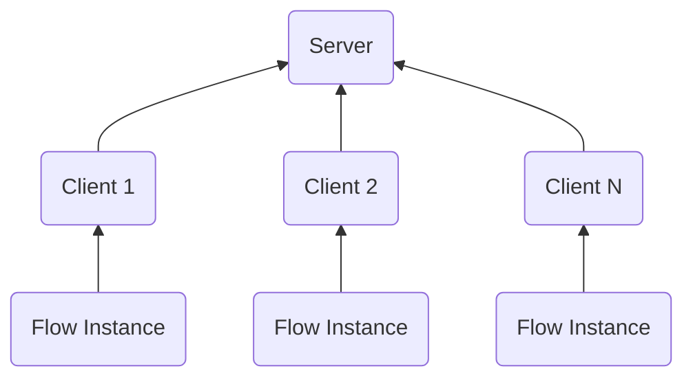
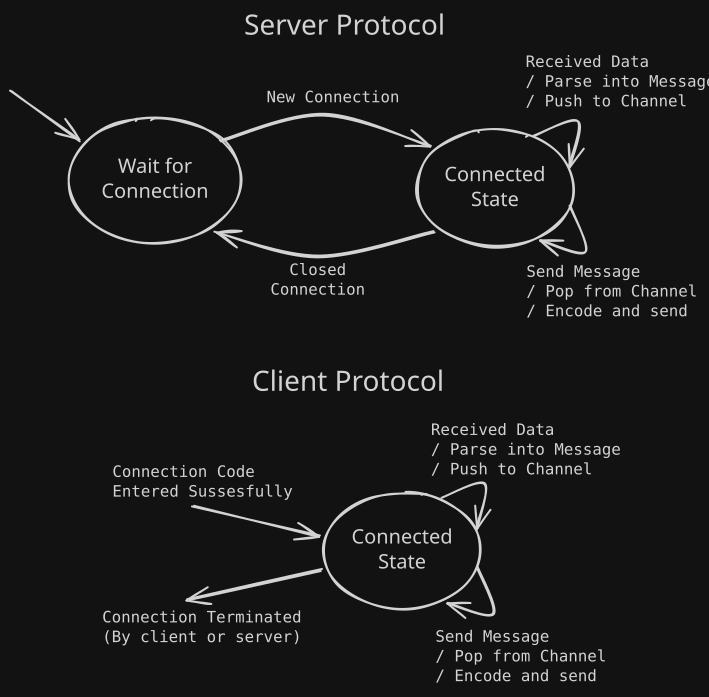

!!! info "Work in Progress"
    This project is in its very early (and experimental) stages. This page outlines some of what has been developed for this project. Although it is developed using cross-platform technologies, it is currently only available for Windows. Due to not being codesigned, feel free to safely ignore security warning that Windows may give.

[:material-download: **Download `RuleFlowRenderEngine.exe`**](https://github.com/RuleFlow-OSS/RuleFlow-RenderEngine/releases/tag/v0.0.1-alpha){ .md-button .md-button--primary }

The *RuleFlow RenderEngine* is a [Godot](https://godotengine.org/)-based `.NET` application (work in progress) designed to provide more advanced rendering, exploration, and analysis capabilities to [RuleFlow Studio](../overview.md). Because RuleFlow Studio follows the Hub-Spoke model, programs responsible for rendering and analysis are often connected via [plugins](../core-plugins.md). *RenderEngine* follows this model by acting as a [peer-to-peer](https://en.wikipedia.org/wiki/Peer-to-peer) *server*, to which *clients* (Flows) connect. As a consequence of this design, RenderEngine implements a custom [application-layer](https://en.wikipedia.org/wiki/Application_layer) protocol over [TCP](https://en.wikipedia.org/wiki/Transmission_Control_Protocol). This allows for multiple RuleFlow instances to connect to a RenderEngine instance over a network (or via LocalHost if running both RenderEngine and Studio on the same machine). More details regarding the implementation of RenderEngine are discussed below.

## Custom Streaming Protocol (over TCP)

RuleFlow events are streamed via *messages*. Because RenderEngine acts as the *server* (meaning it it waits for a connection request), but does not perform the Flow simulations, most *messages* are sent from the client to the server. The above diagram encapsulates why we chose to make the RenderEngine the *server side*: it allows for multiple Flows instances to be connected as clients to a single RenderEngine server. Currently, however, we only allow a single client to be connected at any given time. Later, we will extend RenderEngine support for multiple clients (the code for the server is already there, its just a matter of make the user interface support multiple Flows).

Currently, there are two types of messages in our protocol:

- `EventMessage`: This type of message contains the *event index* (sent per evolution step), the *causal distance* metric, and the *causally connected events* vector.
- `CommandMessage`: This type of message handles sending commands such as `evolve`, `clear`, `regress`, `ping/pong`, etc. It consists of the *operation name* and *arguments*.

Our protocol uses length-prefixed JSON over TCP. Then, on both the client side and server side, the received messages are validated and parsed into [polymorphic](https://en.wikipedia.org/wiki/Subtyping) `Message` objects that can be interpreted by either side. This protocol is still in its very early stages, so the structure of these objects is subject to change as the protocol is refined.

The RenderEngine server uses the connection-oriented approach, thus once a connection is established between the client and server, messages are free to flow back and forth. In order to facilitate efficient communication between the client and server, we follow the [producer-consumer pattern](https://www.cs.cornell.edu/courses/cs3110/2010fa/lectures/lec18.html): this way we keep the Client/Server processes [decoupled](https://en.wikipedia.org/wiki/Loose_coupling) from RuleFlow/Rendering logic. Messages are enqueued/dequeued from a message [channel](https://en.wikipedia.org/wiki/Channel_(programming)) by both sides sending and receiving sides of the Client/Server; this allows for concurrency and clean software design.

The [FSMs](https://en.wikipedia.org/wiki/Finite-state_machine) for both the Client and Server are given below:

